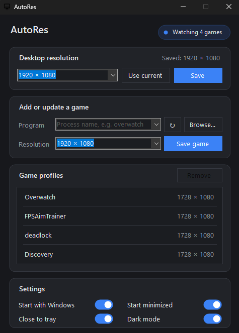
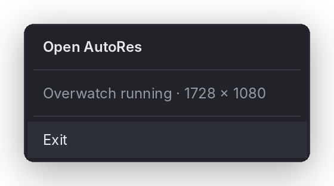

# AutoRes

**Switches your monitor to a game's resolution while the game runs, and switches back when it closes.**

Handy for stretched resolutions (e.g. 1728×1080 in Overwatch, 1440×1080 in Valorant) without touching Windows display settings every time.



## Features

- **Automatic switching:** detects when a saved game starts and applies its resolution, then restores your desktop resolution when it exits
- **Game profiles:** one resolution per game; pick it from the running programs list or browse to its `.exe`
- **Supported modes only:** resolution dropdowns list what your monitor actually supports
- **Runs in the tray:** left-click to show/hide, right-click for **Open** / **Exit**
- **Start with Windows**, start minimized, close-to-tray
- **Light and dark mode**, including a dark title bar
- **Safe switching:** the game resolution is applied temporarily, so a crash or reboot never leaves you stuck on it



## Download

1. Grab the `.zip` from the [latest release](https://github.com/kuhmori/AutoRes-Monitor-Resolution-Switcher/releases/latest)
2. Extract it anywhere and run `AutoRes.exe`

Requires Windows 10 or 11 with .NET Framework 4.8 (already included in Windows).

## How to use

1. **Desktop resolution:** pick your normal resolution (or click **Use current**) and click **Save**.
2. **Add a game:** start the game, click **↻** and pick it in **Program**, or type its process name, or use **Browse…** to select its `.exe`. Choose a **Resolution** and click **Save game**.
3. **Play:** the status in the top right turns green and shows the active game. Close the game and your desktop resolution comes back.

Click a profile to edit it, or select it and press **Remove** / Delete.

## Build from source

Requires the [.NET SDK](https://dotnet.microsoft.com/download) or Visual Studio 2019+.

```bash
git clone https://github.com/kuhmori/AutoRes-Monitor-Resolution-Switcher.git
cd AutoRes-Monitor-Resolution-Switcher/AutoRes
dotnet build -c Release
```

The exe ends up in `AutoRes/bin/Release/`. On Windows you can also just double-click `AutoRes/build.bat`.

## Troubleshooting

| Problem | Fix |
| --- | --- |
| "isn't supported by this display" | Choose a resolution from the dropdown; your GPU/monitor doesn't offer the one you typed. For custom stretched resolutions, add them in NVIDIA/AMD/Intel control panel first. |
| Resolution doesn't change | Check the process name in Task Manager → Details (without `.exe`). Some games run under a different exe than their launcher. |
| Game resets the resolution | Set the game itself to fullscreen at the same resolution, or borderless. |

Settings are stored in `%APPDATA%\AutoRes\settings.xml`.

## Project layout

```
AutoRes/
├── Program.cs            Entry point, single-instance handling
├── MainForm.cs           Window layout, tray menu, game monitoring
├── Controls.cs           Themed controls (cards, toggles, status, profile list)
├── Theme.cs              Light/dark palettes, tray menu renderer
├── AppSettings.cs        Settings file + Windows autostart
├── ResolutionHelper.cs   Windows display API wrapper
├── NativeMethods.cs      Dark title bar, native control themes
└── build.bat             One-click Windows build
```

## Changelog

**v1.1.0**
- Redesigned interface with full dark mode
- Tray right-click menu (Open / Exit) and close-to-tray
- Supported-resolution dropdowns, Browse for `.exe`, click a profile to edit it
- Single instance, embedded icon, sharp on high-DPI screens
- Temporary game resolution (no more getting stuck after a crash)

**v1.0.0**
- Initial release: game profiles, automatic switching, dark mode, tray, autostart

## Disclaimer

AutoRes changes your display settings. Use at your own risk.
